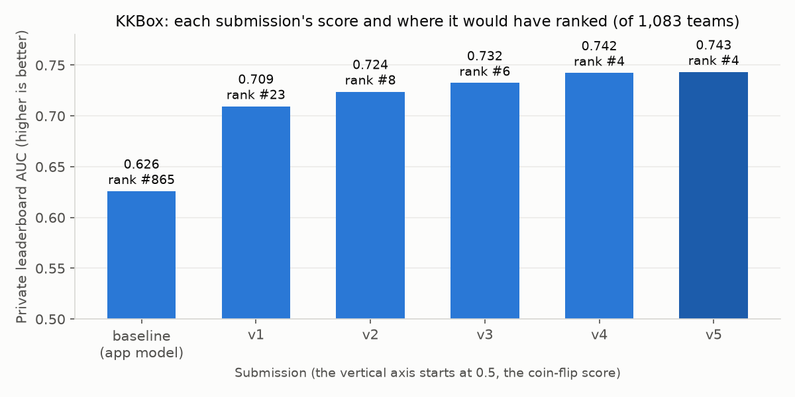

::: {.callout-note}
## Who this guide is for
No statistics, machine learning or programming needed. Technical words are explained when they first appear and again in the [Glossary](#glossary). Every number comes from the project's own files: the README, the research report, the two notebooks, and the saved models and data.
:::

# The question in one paragraph

Every music app must decide *what should this person hear next?* There are two classic answers. **Content-based** recommendation looks at the songs: "you liked this, and that one **sounds like it**." **Collaborative filtering** looks at people: "**listeners like you** came back to this song." This project builds one working system of each kind on real public data. It tests each one honestly and puts them side by side. The content-based half uses about 114,000 Spotify tracks. The collaborative half uses 7.4 million real listening events from KKBox, a Taiwanese music streaming service. A late entry from that half into a past competition would have ranked **4th of 1,083 teams**.

# Why it matters

Recommendations shape much of what people hear, watch and buy. The two approaches need different data and fail in different ways:

- **Content-based** needs only a description of each item, so it works for a song nobody has played yet. But it only finds songs that *measure* alike. It cannot hear lyrics, language or era.
- **Collaborative filtering** captures taste that no description holds, but it needs lots of history. It knows nothing about a brand-new song or user. This is the **cold-start problem**.

As the project's report puts it, the real question is not "which is better" but "what data do I actually have?" Building both on real data makes that trade-off concrete.

# The data, explained

## Spotify tracks (content-based)

This is a free dataset from Kaggle, a website for public datasets and data-science competitions. It has **114,000 rows**: about 1,000 tracks for each of **114 genre labels**. Each track has **audio features**, which are measurements Spotify computes from the sound. (A **feature** is one measurable fact about an item, like "energy = 0.88".) Popular tracks appear several times under different genre labels: **24,259** rows are repeats. Keeping each track once leaves **89,741 tracks** and **113 labels**.

Six real tracks:

| Track | Artist | Genre label | Danceability | Energy | Acousticness | Valence | Tempo (BPM) |
|---|---|---|---|---|---|---|---|
| Bohemian Rhapsody (Remastered 2011) | Queen | rock | 0.41 | 0.40 | 0.27 | 0.22 | 71 |
| Clair de Lune, L. 32 | Claude Debussy; Martin Jones | classical | 0.34 | 0.01 | 0.99 | 0.04 | 66 |
| Stranded | Gojira | death-metal | 0.51 | 0.88 | 0.00 | 0.50 | 92 |
| Quevedo: Bzrp Music Sessions, Vol. 52 | Bizarrap; Quevedo | hip-hop | 0.62 | 0.78 | 0.01 | 0.55 | 128 |
| Words (feat. Zara Larsson) | Alesso; Zara Larsson | edm | 0.74 | 0.59 | 0.02 | 0.44 | 124 |
| Clean White Noise (Loopable) | White Noise Baby Sleep | sleep | 0.00 | 0.00 | 0.79 | 0.00 | 0 |

- **Genre label**: a human-assigned tag. The recommender **never sees it**. It is only used afterwards, to grade results.
- **Danceability** (0 to 1): how danceable the rhythm is.
- **Energy** (0 to 1): how intense it feels. The metal track scores 0.88; Debussy scores almost 0.
- **Acousticness** (0 to 1): how likely the track is acoustic rather than electronic.
- **Valence** (0 to 1): musical positivity, from sad to cheerful.
- **Tempo**: beats per minute. White noise has no beat, so it scores 0.

The file also has loudness, speechiness, instrumentalness, liveness, key, major/minor mode, beats per bar, length, an explicit flag, and a 0-to-100 **popularity** score.

## KKBox listening logs (collaborative filtering)

This data is from the Kaggle competition "WSDM KKBox's Music Recommendation Challenge", which closed in 2017. It asks: **when a member plays a song, will they play it again within a month?** The tables:

- **Training events**: 7,377,418 rows, one per listening event, answer included.
- **Test events**: 2,556,790 rows with the answer hidden. Kaggle scores entries against the hidden answers.
- **Members**: 34,403 rows (city, self-reported age, gender, sign-up details).
- **Songs**: about 2.3 million rows (length, genre codes, artist, composer, lyricist, language, name, recording code).

The first six training rows (IDs shortened, song names looked up in the song tables):

| Member | Song | Source tab | Source screen | Source type | Replayed within a month? |
|---|---|---|---|---|---|
| FGtllVqz… | Good Grief (Bastille) | explore | Explore | online-playlist | yes |
| Xumu+NIj… | Lords of Cardboard | my library | Local playlist more | local-playlist | yes |
| Xumu+NIj… | Hip Hop Is Dead (Nas) | my library | Local playlist more | local-playlist | yes |
| Xumu+NIj… | Disco Africa (Soundway) | my library | Local playlist more | local-playlist | yes |
| FGtllVqz… | Sleep Without You (Brett Young) | explore | Explore | online-playlist | yes |
| FGtllVqz… | Panda (Desiigner) | explore | Explore | online-playlist | yes |

- **Member / Song**: scrambled IDs.
- **Source tab / screen / type**: where in the app the play started (own library, discover, search, radio, a playlist...).
- **Replayed within a month?**: the answer to predict.

The same two members in the members table:

| Member | City code | Age (`bd`) | Gender | Sign-up method | Registered | Expires |
|---|---|---|---|---|---|---|
| FGtllVqz… | 1 | 0 | (missing) | 7 | 2 Jan 2012 | 5 Oct 2017 |
| Xumu+NIj… | 13 | 24 | female | 9 | 25 May 2011 | 11 Sep 2017 |

An age of 0 is a first taste of the data-quality problems below.

# The journey, step by step

## Part A: Content-based (Spotify)

1. **Clean, and hide the answer key.** Repeated tracks are removed. *Popularity* is kept out of the recommender's inputs, because it measures fame, not sound. *Genre* is kept out because it is the grading key. Letting a model see the answer is called **leakage**, and it produces results that look great but mean nothing.
2. **Turn each track into 25 numbers.** Three features are added. **Musical key goes on a circle**, because after B comes C again, so they are neighbours, not opposites. **Length is converted to minutes**. A **mood label** (energetic or calm, happy or dark) comes from a psychology model of emotion (Russell's), mainly for readability. All numbers are then **rescaled** so that tempo (0 to about 240) cannot swamp danceability (0 to 1).
3. **Find the nearest neighbours.** Picture every track as a dot on a map, where tracks that measure alike sit close together. To recommend, return the 10 dots closest to the seed. This is a **nearest-neighbours search**.
4. **Try three ways to improve the map.**
   - **Weighting**: train a **classifier**, a model that predicts a category (here, genre), and give more weight to the features it finds most useful.
   - **PCA**: squeeze the 25 numbers into 10 summary combinations.
   - **NCA**: learn a new map designed so that neighbours share a genre. It is memory-hungry: training on all of the roughly 72,000 training tracks crashed, so it learned from a random 5,000 instead.
5. **Grade honestly.** With no record of what listeners liked, genre is the stand-in judge. Hold back 20% of tracks as test questions. Recommend 10 for each from the rest, and count the share that match the seed's genre. That share is **precision@10**. Every method is compared with a **baseline**, the simplest possible approach: "give everyone the same 10 most popular tracks."
6. **Question the grading.** Some labels are near-synonyms ("singer-songwriter" and "songwriter"), so the project also grades against **13 broader families**. One of them is a bucket for mood tags like "chill" or "sleep", which are not genres at all. Notebook 01 also checks whether the same recording, released under two IDs, flatters the score.
7. **Explain it.** **SHAP**, a standard method that splits a model's output into a contribution from each feature, shows which audio features best separate genres.
8. **Ship it.** The final weighted recommender covers all 89,741 tracks. It is saved once and loaded by the app, the command-line script and the notebook, so they cannot disagree.

## Part B: Collaborative filtering (KKBox)

1. **Check the data instead of trusting it.** Age is unusable for about **58%** of members (zeros, negatives, a maximum of **1,051**); anything outside 5 to 100 becomes "unknown". Gender is missing for about 58% of members, composer for 47% of songs, lyricist for 85%, so these become "filled in?" flags. There are **222,363** artist names. The answer is nearly balanced: **50.4%** replayed.
2. **Explore.** The rows are in time order, though there are no dates. Cut into ten slices, the replay rate **falls from 0.710 to 0.394**, so the past does not look like the future. How a song was reached matters: recomputed for this guide, about 62% of plays from "my library" were replayed, against about 22% from "radio". Members are consistent over time, and popular songs get replayed more.
3. **Build the explainable "app model".** Instead of millions of raw IDs, it counts how often each song, member and artist appears. A brand-new song gets 0, which is itself a signal. It adds cleaned columns: membership length, cleaned age, number of genres, whether a composer is credited, and the recording's country and year.
4. **Compare model types.** Four kinds were compared. A **decision tree** is a flowchart of yes/no questions. **Gradient boosting** (LightGBM and XGBoost are popular tools) builds hundreds of small trees, each fixing the last one's mistakes. A **random forest** is many independent trees that vote. **Logistic regression** is a simpler classic. LightGBM became the default: Random Forest could not finish training on the full data in 500 seconds, while LightGBM took about 91.
5. **Score it, then doubt the score.** The score is **AUC**: pick one replayed and one non-replayed event at random, and ask how often the model scores the replayed one higher. 0.5 is a coin flip; 1.0 is perfect. The report used a random 80/20 split. Notebook 02 showed that is too kind, because the real test comes entirely *after* training and the data drifts. The honest check is a **chronological split**: train on earlier rows, test on later ones.
6. **Build a separate leaderboard model, purely for score.** It always uses the full files. It differs from the app model in three ways:
   - it uses member, song and artist **IDs directly**, so it learns personal habits;
   - it uses **row order as a clock**, for example how soon a member plays again, or which song came just before or after;
   - it counts over **training and test rows together**, about 9.9 million rows and roughly 195 columns, using no answers.

   It also adds three things:
   - **Taste vectors**: short number summaries of each member and song, computed by a technique called **SVD**, so that similar listeners look similar even without shared songs. This is "people like you" in maths.
   - **Past replay rates** (**target encoding**), using only answers from earlier blocks of 1.5 million rows. Fresher answers made the validation score *drop* (0.741 to 0.726), because the real test is weeks stale.
   - **Heavy regularisation**: settings that stop the model memorising individuals. These settings and several feature ideas were adapted from the 1st-place solution's published code; the implementation is the project's own.

   Each version was checked chronologically (first 80% of training rows against the last 20%), refit on everything and submitted. These were **late submissions**: the competition had closed, so ranks were worked out against the saved final leaderboard.
7. **Loose ends.** An experimental **neural network**, a different style of model, was never finished: one run was stopped, it has no score, and it was never submitted. A **blending** script (averaging several models) exists, but there has only ever been one model to blend.
8. **Explain and use.** SHAP is applied to the app model, which also powers the app's Predict page.

# What we found

## Content-based results

| Approach | Precision@10 (exact genre) |
|---|---|
| Popularity baseline | 0.009 |
| Plain nearest neighbours | 0.141 |
| **Weighted nearest neighbours** | **0.161** |
| PCA nearest neighbours | 0.138 |
| NCA nearest neighbours | 0.152 |

- **Audio carries real genre signal.** Every method beats the baseline more than tenfold. A random pick matches about 1 time in 113.
- **Simple won.** Weighting beat both fancier techniques. PCA was slightly worse than nothing, and NCA landed in between, perhaps limited by its 5,000-track sample. Fancier is not automatically better; you have to measure.
- **Looser grading flatters everyone.** At family level, the recommender scores 0.331 and the baseline 0.123. The recommender's edge is about **18 times** the baseline at exact genre but only about **2.7 times** at family level. That is why the stricter number is the honest headline.
- **Twins inflate the score a little.** 13.0% of test tracks had a same-name, same-artist twin in the catalogue. Without them, precision drops from 0.161 to 0.136, still about 15 times the baseline. Precision also falls as you ask for more suggestions.
- **Instrumentalness and acousticness** separate genres best, then danceability: "acoustic or electronic? vocals or not?"

**A real example**, from the saved recommender, run the way the app does. Seed: *Clair de lune* by Debussy (Alice Sara Ott recording, label "classical"):

| Rank | Track | Artist | Genre label |
|---|---|---|---|
| 1 | Clair de Lune, L. 32 | Claude Debussy; Martin Jones | classical |
| 2 | River Dawn, Part 7 | Catherine Marie Charlton | new-age |
| 3 | Gnossienne No. 1 | Erik Satie; Alena Cherny | classical |
| 4 | Nocturne No. 19 in E Minor | Frédéric Chopin; Benjamin Grosvenor | classical |
| 5 | Luminous | Ludovico Einaudi | ambient |
| 6 | Luminous | Ludovico Einaudi | ambient |
| 7 | Erase | Líom | ambient |
| 8 | Distant Dreams | Euloria | sleep |
| 9 | Nocturne No. 2 in E-Flat Major | Frédéric Chopin; Daniel Barenboim | classical |
| 10 | When Will My Life Begin (from "Rapunzel") | The Sleep Diaries | disney |

All ten are quiet, nearly fully acoustic and instrumental, with almost no energy, just like the seed. Only 4 carry the "classical" label, yet a listener would likely accept them all. Number 1 is another recording of the same piece, and "Luminous" appears twice under two IDs: the twin effect in action. *Bohemian Rhapsody* (label "rock") fares differently. Its neighbours are slow, mid-energy Turkish, Indian, worship and folk songs plus one Opeth track, and **none** is labelled rock. Audio numbers cannot hear language or era.

## Collaborative filtering results

**App model** (sources: report, notebook 02):

- On a 300,000-row sample, random split: XGBoost 0.714, LightGBM 0.714, Random Forest 0.694, Logistic Regression 0.688 AUC.
- LightGBM on all 7.4 million rows, random split: **0.725** (trained on 5,901,934 rows, tested on 1,475,484).
- **The random split misled.** On a 400,000-row sample the same model scored 0.712 split randomly but **0.627** split by time. Kaggle's actual score for it was **0.626**. Lesson: *test the way you will be tested.*
- A member's own past replay rate alone scores 0.588. The app model beats it by only about 0.04, because it never learns *who* the member is.
- SHAP: the app model leans on **play counts** and **listening context** (such as "my library"). Age barely matters.

**Leaderboard model** (source: README; ranks re-checked in notebook 02 against the saved final leaderboard):

| Version | What was added | Time-based check | Private leaderboard AUC | Would rank |
|---|---|---|---|---|
| baseline | the app model | not run | 0.626 | #865 |
| v1 | IDs used directly, counts over train + test, time gaps | 0.732 | 0.709 | #23 |
| v2 | activity windows, block past-replay rates, more smoothing | 0.745 | 0.724 | #8 |
| v3 | taste vectors (SVD) | 0.758 | 0.732 | #6 |
| v4 | previous/next song, sessions, preference shares, heavy regularisation | 0.765 | 0.742 | #4 |
| **v5** | v4, retuned learning speed and more rounds | 0.766 | **0.74320** | **#4 of 1,083** |

Using identities and time order (v1) was the biggest jump, from rank 865 to 23. Only three original teams beat v5. Regularisation alone moved the time-based check from 0.761 to 0.765. Retrained on a 20% sample in notebook 02, the leaderboard model scored 0.755 on its time-based check, far above the app model's 0.627 (different samples, so compare roughly).

**One member's suggestions.** Using the saved app model, as in notebook 02, the most active member late in the data (3,926 plays) was scored on 15 popular recent songs they had never played, reached via "discover":

| Song | Artist | Replay chance (discover) | (my library) |
|---|---|---|---|
| 不為誰而作的歌 (Twilight) | JJ Lin | 81% | 82% |
| Shape of You | Ed Sheeran | 80% | 78% |
| I Miss You | Soyou | 79% | 77% |
| Beautiful | Crush | 77% | 76% |
| 不關你的事 (Not Your Business) | The Last Day of Summer 831 | 76% | 69% |

Sorting by this score turns a replay predictor into a recommender. The averages over all 15 were 70.9% (discover) and 72.8% (library). The ranking comes mostly from song popularity, because the app model does not know this member's taste. The leaderboard model does, but it is not connected to the app.

## Head to head

Precision@10 and AUC measure different tasks, so neither number is "better". The decisive practical difference is **cold start**: a new Spotify track can be recommended as soon as it is measured, while a new KKBox song or member has no history. Both halves share the same discipline: hold data back, beat a baseline, and measure costs (NCA's memory, Random Forest's time) rather than assume them.

# How to read the main charts

{fig-alt="Two radar charts with six spokes (danceability, energy, acousticness, instrumentalness, liveness, valence) from 0 at the centre to 1 at the rim. Left: seed and top-pick shapes overlap almost exactly. Right: similar but not identical shapes."}

**Radar charts** (app Recommend page; this figure was made in the same style from the saved recommender). Each spoke is one feature, from 0 at the centre to 1 at the rim, so each track becomes a shape. **The more two shapes overlap, the more alike the tracks measure.**

{fig-alt="Bar chart of six submissions rising from 0.626 for the app model to 0.743 for v5, with would-be ranks improving from 865 to 4."}

**Leaderboard progress.** Taller is better. The axis starts at 0.5, the coin-flip score. Small steps at the top matter: 0.732 to 0.743 moved the entry from 6th to 4th.

Other charts in the app, report and notebooks:

- **Bar charts of precision@10 or AUC**: one bar per method. Find the baseline bar first; everything must beat it.
- **"Mean |SHAP value|" bars**: a longer bar means the model relies on that feature more. They show importance, not direction.
- **Exact genre vs genre family**: the baseline's bar grows far more, in relative terms, than the recommender's.
- **Valence-against-energy scatter**: each dot is a track, coloured by mood corner. The colours blend at the borders because mood is continuous.
- **Histograms**: how many items fall in each value range. For example, cleaned ages now look like real ages instead of a spike at zero.

# Try it yourself

**The app** (<https://recommendation-showcase.streamlit.app>, or run `streamlit run app/streamlit_app.py`) has eight pages.

*Content-Based (Spotify)*

- **Recommend**: search for a song, pick 3 to 20 suggestions, and press *Recommend*. You get a ranked list with distances (smaller means closer), a radar chart of the seed against the top pick, and the share of suggestions with the seed's genre.
- **Overview**: counts, the most common genres, feature spreads, and popularity against each feature (why popularity was left out).
- **Feature Engineering**: key on a circle, track lengths, and the mood scatter.
- **Model Insights**: the five-method comparison (with a slider for how many suggestions are graded), exact versus family grading, and SHAP.

*Collaborative Filtering (KKBox)*

- **Predict**: load a random member and song, choose how the song was reached, and press *Predict replay probability*.
- **Overview**: counts, replay balance, replay rate by context, and the data-quality problems.
- **Feature Engineering**: play counts, age clean-up, composer and lyricist flags, and release years.
- **Model Insights**: the four-model comparison and SHAP.

::: {.callout-warning}
## The hosted app runs on small samples
For fast loading, the app starts from bundled samples. The Spotify sample is a real subset, and in this mode the recommender is the plain, unweighted version. The KKBox files cannot be redistributed, so the app's KKBox tables are **stand-ins**. Member and song IDs are real, but the details are made up, and the listening rows are generated with the saved model. Treat those pages as a demonstration, not a finding. Setting `USE_FULL_KAGGLE_DATA=true`, with Kaggle access, switches to the full data.
:::

**The research report**: `report/report.html` (and `.pdf`), also at <https://nhamhung.github.io/recommendation-showcase/>. It covers both approaches and the head-to-head comparison, but not the leaderboard work.

**The notebooks** are step-by-step guides for readers who know basic Python. `notebooks/01_content_based.ipynb` goes from the raw file to a recommendation. `notebooks/02_collaborative_filtering.ipynb` covers exploration, the app model, the split lesson and the full leaderboard pipeline.

**Scripts and tests**: `scripts/recommend.py "song name"` prints suggestions. Other scripts rebuild the models and write Kaggle submissions. Tests in `tests/` check pieces such as the key circle, the age clean-up and that past replay rates never peek ahead. They use small made-up data, so no download is needed.

# What this project can't tell you

- **Whether listeners would like the Spotify suggestions.** Genre matching is an imperfect stand-in: Debussy got good picks with "wrong" labels; Queen got the reverse.
- **Anything about lyrics, language or era** on the content side. Only audio measurements are used.
- **Live performance of the leaderboard model.** Its strongest features peek at *later* plays: the next song, how soon a member returns. That is allowed in the competition, where the whole test file is given at once, but impossible in a live app.
- **How much the scores would wobble.** The app model's 0.725 comes from one random split. Its variability was not measured, and the split itself proved too optimistic.
- **Whether results hold elsewhere or later.** KKBox behaviour drifts over time, and both datasets are fixed snapshots.
- **Anything about the neural network or blending.** Neither produced a result. Notebook 02 also notes that the saved validation predictions score 0.761, an earlier run rather than v5's 0.766. That is flagged as an inference.

# Glossary {#glossary}

**AUC**: the chance a model scores a random "yes" case above a random "no" case. 0.5 is a coin flip; 1.0 is perfect.

**Audio features**: Spotify's measurements of a track's sound (energy, danceability...).

**Baseline**: the simplest possible method; a real model must beat it.

**Blending**: averaging several models' predictions.

**Chronological split**: train on earlier data, test on later data.

**Classifier**: a model that predicts a category.

**Cold start**: new users or items have no history, so history-based methods know nothing about them.

**Collaborative filtering**: recommending from many users' behaviour ("people like you...").

**Content-based recommendation**: recommending items whose own properties resemble what you liked.

**Decision tree**: a flowchart of yes/no questions ending in a prediction.

**Feature**: one measurable fact used as model input.

**Gradient boosting**: many small trees built in sequence, each fixing earlier errors (LightGBM, XGBoost).

**Kaggle**: a website hosting datasets and competitions with leaderboards.

**Leakage**: a model seeing information it would not have in real use, such as the answer or the future.

**Leaderboard (public/private)**: competition rankings. The private board, on hidden data, decides final places.

**Logistic regression**: a simple classic method that weighs features into a probability.

**Model**: a procedure learned from data that turns inputs into predictions.

**Nearest neighbours**: the items whose numbers are closest to a given item's.

**NCA**: a technique that learns a distance under which neighbours share a label.

**Neural network**: a flexible model built from layers of simple calculations.

**PCA**: compresses many features into fewer summary combinations.

**Precision@k**: the share of the top *k* suggestions that are "right".

**Random forest**: many independent decision trees that vote.

**Regularisation**: settings that stop a model memorising its training data.

**SHAP**: splits a model's output into each feature's contribution.

**SVD**: summarises a member-by-song table into short "taste vectors".

**Target**: the answer to predict, here "replayed within a month?".

**Target encoding**: replacing an ID with its past "yes" rate, from earlier data only.

**Validation**: testing a model on held-back data to estimate real-world performance.
